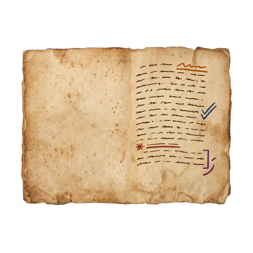
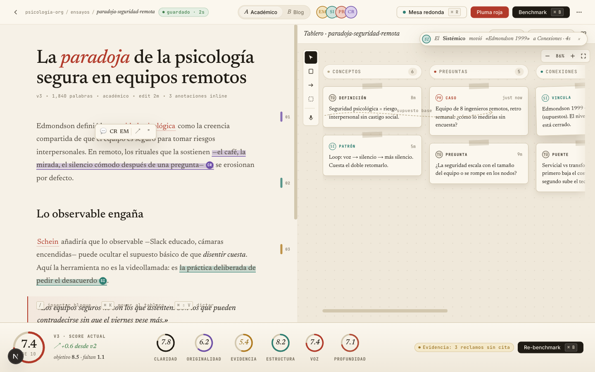
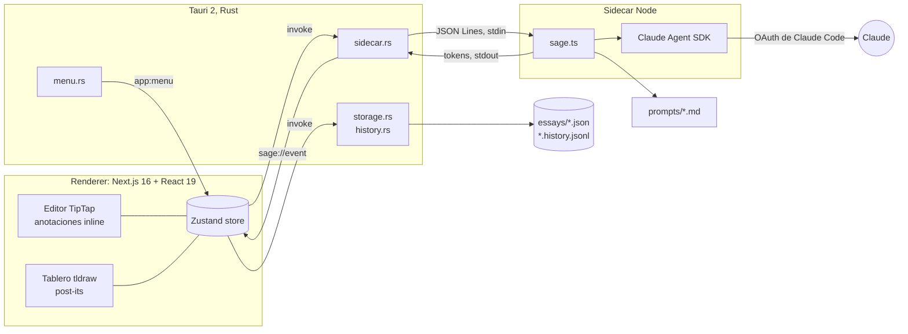

<div align="center">

<!-- TODO: crear docs/banner-dark.png y docs/banner-light.png (1280x640) con la paleta de noeosorio.com (fondo #18181b, acento #bef264 → #10b981) y descomentar
<picture>
  <source media="(prefers-color-scheme: dark)" srcset="docs/banner-dark.png">
  
</picture>
-->



# Essay Studio

**Cuatro agentes de IA que te hacen preguntas, anotan y puntúan tus ensayos mientras los escribes.**


[Features](#-features) | [Quickstart](#-quickstart) | [Arquitectura](#️-arquitectura) | [Roadmap](ROADMAP.md)

</div>

Essay Studio es una app de escritorio para escritura aumentada con IA: un editor de texto, un tablero de post-its y cuatro agentes con voces distintas (Evidencia, Sistemas, Práctica y Objeciones) que te cuestionan a ti en lugar de escribir por ti. Nació para aprender psicología organizacional escribiendo ensayos, con una regla: el puntaje no se le pide al modelo, se calcula a partir de hallazgos concretos que puedes ver, aplicar o descartar.

## ✨ Features

| | Feature | Qué hace |
|---|---|---|
| 🧑‍⚖️ | **Cuatro agentes** | Evidencia, Sistemas, Práctica y Objeciones. Cada uno tiene su voz en [`prompts/`](prompts/) y su color en todo el escritorio. |
| ❓ | **Hazme preguntas** | Eliges una fuente (se busca por nombre, o sueltas una nueva) y los agentes activos te hacen 3 preguntas cada uno. Llegan una a una al tablero como notas, sin mover las tuyas, y también puedes añadir tu propia pregunta. |
| 🖍️ | **Revisar ensayo** | Pasadas de coherencia, estilo, argumento y citas APA (esta última solo en modo académico). Los hallazgos quedan subrayados en el texto, sin paso de aplicar, y todos viven en Correcciones, ordenados como el ensayo y filtrables por criterio. |
| 📐 | **Rúbrica** | Pegas la consigna o sueltas su PDF y los criterios aparecen solos con su peso, listos para ajustar. Nada se reemplaza sin que lo confirmes. |
| 📚 | **Fuentes** | Sueltas PDFs, archivos de texto o texto pegado, y el título, los autores, el año y la cita APA se completan solos. La lista se busca y se usa en cada revisión. |
| 💮 | **Sello de puntaje** | El puntaje por criterio parte de 10 y baja según la severidad de cada hallazgo abierto. Un 10 significa que no queda nada por corregir, y el sello avisa cuando el ensayo cambió desde la última revisión. |
| 🗂️ | **Biblioteca de ensayos** | Una lista que sigue siendo ágil con mil ensayos: el último a la vista, búsqueda en el texto, filtros y salto por mes. |
| 🕰️ | **Historial de versiones** | Versiones automáticas cada 10 minutos y al cerrar, más guardado manual. Antes de restaurar siempre se guarda una copia de seguridad. |
| 🌐 | **ES / EN por ensayo** | Los agentes te explican en el idioma del ensayo, y cada reemplazo respeta el idioma del fragmento citado. |
| ⌨️ | **Menú nativo con atajos** | Todas las acciones tienen atajo de teclado (ver abajo); en pantalla el atajo solo aparece en el tooltip. |
| 🔒 | **Local-first, sin API key** | Los ensayos se guardan como JSON en tu máquina. Los agentes usan la sesión OAuth de Claude Code que ya tienes. El texto de los PDFs se extrae en tu Mac; a los agentes solo les llega lo que necesitan: el comienzo de una fuente al completar su título y su cita (12.000 caracteres), hasta 80.000 caracteres de una consigna al sacar su rúbrica, y el ensayo con sus fuentes al revisar. |

<details>
<summary>Atajos de teclado</summary>

| Atajo | Acción |
|---|---|
| `⌘N` | Nuevo ensayo |
| `⌘W` | Cerrar ensayo |
| `⌘⇧P` | Hazme preguntas |
| `⌘⇧E` | Revisar ensayo |
| `⌘K` | Buscar ensayos |
| `⌘⇧R` | Rúbrica |
| `⌘⇧F` | Fuentes |
| `⌘⇧⌫` | Limpiar revisión |
| `⌘⇧H` | Historial de versiones |
| `⌘\` | Mostrar / ocultar tablero |

</details>

## 🖼️ Demo

<!-- TODO: agregar docs/demo.gif (Hazme preguntas → notas → Revisar ensayo → aplicar reemplazo) y una captura actual de la app -->
<p align="center">
  
</p>

## 🚀 Quickstart

> [!IMPORTANT]
> Para usar a los agentes necesitas Claude Code con una sesión de suscripción compatible. El sidecar reutiliza esa sesión OAuth y su uso cuenta contra los límites del plan; no promete un crédito mensual separado ni recurre a una API key. Consulta la [guía de Anthropic para usar el SDK con tu plan](https://support.claude.com/en/articles/15036540-use-the-claude-agent-sdk-with-your-claude-plan).

**Requisitos**

- Node 20+ y npm 10+
- Rust 1.88+ (`rustup update stable`)
- Dependencias nativas de Tauri: en macOS, `xcode-select --install`. Para otros sistemas, ver los [prerequisitos de Tauri](https://v2.tauri.app/start/prerequisites/).

```bash
git clone https://github.com/NoeOsorio/essay-studio.git && cd essay-studio
npm install
npm run sidecar:install     # deps del sidecar (Claude Agent SDK)
npm run sidecar:build       # compila sidecar/dist/sage.js
npm run tauri:dev           # Next + ventana Tauri + sidecar
```

> [!NOTE]
> La primera vez, `tauri:dev` compila ~470 crates y tarda de 5 a 10 minutos. Las siguientes corridas tardan segundos. Si ya tienes `next dev` corriendo en `:3000`, detenlo antes.

**Build distribuible**

```bash
npm run tauri:build:full    # recompila el sidecar y luego empaqueta
```

El bundle queda en `src-tauri/target/release/bundle/` (`.app` / `.dmg` en macOS, `.msi` en Windows, `.deb` / `.AppImage` en Linux). Para abrir el `.app` hacen falta Node 20+ y Claude Code con sesión iniciada. Si falta alguno, la app lo avisa con un banner, y el editor y el tablero siguen funcionando.

<details>
<summary>Todos los scripts</summary>

| Script | Qué hace |
|---|---|
| `npm run dev` | Solo Next en `http://localhost:3000` (sin Tauri: persistencia y agentes desactivados). Útil para iterar estilos. |
| `npm run build` | Export estático de Next a `./out` |
| `npm run lint` | ESLint |
| `npm run test:e2e` | Suite Playwright headless |
| `npm run test:e2e:ui` | Suite Playwright con UI interactiva |
| `npm run sidecar:install` | Instala deps del sidecar |
| `npm run sidecar:build` | Compila el sidecar a `sidecar/dist/sage.js` |
| `npm run tauri:dev` | App completa en modo desarrollo |
| `npm run tauri:build` | Empaqueta usando el sidecar ya compilado |
| `npm run tauri:build:full` | Compila el sidecar y empaqueta (recomendado para release) |
| `npm run tauri` | CLI de Tauri, p. ej. `npm run tauri -- icon branding/logo-1024.png` |

</details>

**Tests**: 110 specs E2E con Playwright (el sidecar está stubbed, así que no consumen créditos) y 33 tests de Rust.

```bash
npm run test:e2e
cargo test --manifest-path src-tauri/Cargo.toml
```

## ⚙️ Configuración

### Benchmarks de revisores y modelos

La pantalla **Revisar ensayo** permite seleccionar un perfil para las siguientes
revisiones. El perfil actual se conserva por defecto; los modelos nuevos aparecen
como candidatos y su acceso no se presupone. El registro de perfiles está en
`sidecar/src/model-profiles.ts`. Cada evaluación nueva registra el modelo que
realmente respondió y la procedencia del prompt y las fuentes; las antiguas
aparecen como «modelo no registrado».

Las anotaciones pueden incluir fragmentos de fuentes con ubicación literal.
La app distingue una coincidencia literal de la comprobación de que esa fuente
respalde el diagnóstico. Si el ensayo o sus fuentes cambian durante una revisión,
es necesario volver a evaluar antes de aplicar el resultado.

```bash
npm run sidecar:build
npm --prefix sidecar run eval:validate
npm --prefix sidecar run eval:dry-run -- --profiles sonnet-5.5,opus-5.5
```

Estos comandos validan el corpus y preparan una corrida **sin llamar a modelos**.
El piloto contiene 24 casos contrastantes; sus claves requieren adjudicación
independiente antes de atribuir puntuaciones de calidad a un modelo. Las pruebas
de UI con respuestas simuladas tampoco establecen esa calidad. Las instrucciones
de uso, el protocolo de evaluación ciega y la autorización de consumo están en
[benchmarks/reviewers/README.md](benchmarks/reviewers/README.md).

### MCP local para trabajar dentro de la app

La ampliación permite editar encabezados y objetos del tablero, conexiones y
formato del documento, gestionar fuentes, rúbrica y versiones, e iniciar trabajos
de revisión únicamente por pedido explícito. Incluye importación de imágenes y
video por fragmentos, consultas paginadas y protección ante reintentos. Consulta
`get_basic_info` para descubrir las capacidades de la app conectada.

**[Guía de instalación para Codex, Claude Desktop y Claude Code](docs/mcp-installation.md)**:
preparación, comandos, configuración, verificación y desinstalación por cliente.

El adaptador MCP permite leer el ensayo abierto y la selección, editar texto y
título, crear notas/conexiones y organizar sticky notes en cuadrícula o columnas
por tema. Los cambios usan los editores nativos y su historial de deshacer.
Requiere **macOS, Node 22+ y la nueva versión de Essay Studio abierta**.

```bash
npm --prefix mcp ci --ignore-scripts
npm --prefix mcp run build
codex mcp add essay-studio -- node /RUTA/essay-studio/mcp/dist/mcp/src/server.js
```

Usa la ruta absoluta al repositorio. La configuración local de MCP en Codex se
describe en la [documentación oficial](https://learn.chatgpt.com/docs/extend/mcp?surface=app).
Comprueba que `essay-studio` y sus herramientas estén disponibles en el chat antes
de usarlo; registrar el servidor no demuestra que un chat existente lo haya cargado.

La barra de la app indica si el MCP está disponible, conectado o trabajando.
**Desconectar** revoca la sesión local; **Conectar MCP** crea una nueva.
La conexión usa un socket local autenticado y archivos privados del usuario.
No hay endpoint público, acceso a archivos arbitrarios, ejecución de código ni
llamadas automáticas a los agentes. Windows/Linux no están verificados.

Flujo del agente: `get_basic_info` → leer documento/tablero → editar usando el
`essayId` y la `revision` recibidos → `get_board_image` para comprobar el resultado
→ `finish_work`. Si cambias el contenido durante una operación, una revisión
antigua se rechaza. Si el guardado falla o el resultado es incierto, el agente
debe leer el estado y reintentar el guardado, sin repetir a ciegas la edición.

`organize_notes` acepta todas las notas, una selección o IDs explícitos. Puede
ordenar en cuadrícula, alinear, distribuir o colocar grupos por tema en columnas.
Conserva texto, colores y conexiones; respeta notas bloqueadas y obstáculos.
La organización se deshace como una sola acción. Los grupos semánticos los
propone el agente después de leer las notas, sin otra llamada a un modelo.

Para QA nativo aislado, el lanzador puede definir `ESSAY_STUDIO_DATA_DIR` como
una carpeta absoluta desechable. El adaptador encuentra esa instancia mediante
`ESSAY_STUDIO_MCP_CONNECTION_FILE=<carpeta>/mcp/connection.json`. Estas opciones
pertenecen al entorno del proceso; ninguna herramienta permite cambiar rutas.

No hace falta `.env`. Estas variables opcionales sirven como override para setups poco comunes:

| Variable | Para qué sirve |
|---|---|
| `SAGE_NODE_PATH` | Ruta explícita al binario de Node que usará el sidecar |
| `SAGE_SIDECAR_PATH` | Ruta a `sage.js` si no está en el bundle ni en el repo |
| `SAGE_PROMPTS_DIR` | Carpeta con las voces `.md` de los agentes |

<details>
<summary>Cómo encuentra Node el <code>.app</code></summary>

Las apps que abres desde Finder o el Dock no heredan el `PATH` de tu shell, así que un Node instalado con nvm, fnm o volta no aparece a simple vista. Rust lo busca en este orden:

1. `SAGE_NODE_PATH`
2. El `PATH` del proceso (cubre `tauri:dev` y `open` desde la terminal)
3. Ubicaciones conocidas: Homebrew, volta, asdf, `/usr/bin` y la versión más alta que haya en nvm/fnm
4. Tu login shell (`$SHELL -lc 'command -v node'`)

Los datos viven en `~/Library/Application Support/com.noeosorio.essaystudio/essays/`, con un `<id>.json` y un `<id>.history.jsonl` por cada ensayo.

</details>

## 🏗️ Arquitectura



- **El renderer no tiene acceso crudo al filesystem.** Toda la I/O pasa por comandos Rust con escritura atómica (tmp + rename).
- **Los agentes corren en un proceso Node aparte** que habla con Rust por JSON Lines, así que el streaming token a token funciona sin abrir puertos.
- **El modelo devuelve citas literales y el frontend las ancla al documento.** Así nadie tiene que calcular offsets de ProseMirror, y las anotaciones viajan dentro del propio documento como marks de TipTap.

## 📁 Estructura

<details>
<summary>Ver estructura</summary>

```text
essay-studio/
├── src/
│   ├── app/                 # layout, page, tokens de diseño (globals.css)
│   ├── components/
│   │   ├── editor/          # TipTap + mark Annotation + popover + slash menu
│   │   ├── canvas/          # tldraw con NoteShapeUtil propio (post-its Pergamino)
│   │   ├── review/          # Revisar ensayo, Correcciones y sello de puntaje
│   │   ├── questions/       # Hazme preguntas y su avance en el tablero
│   │   ├── library/         # lista de ensayos y búsqueda
│   │   ├── panels/          # Rúbrica, Fuentes e Historial
│   │   └── ui/              # primitivos propios (sin librerías de componentes)
│   └── lib/
│       ├── agents/          # preguntas, revisión, parseo de anotaciones
│       ├── benchmark/       # score determinista
│       ├── storage/         # wrappers de invoke + tipos
│       └── store.ts         # Zustand
├── src-tauri/src/           # storage, history, sidecar, menu
├── sidecar/src/sage.ts      # protocolo JSON Lines + Claude Agent SDK
├── prompts/                 # voces de los cuatro agentes
├── tests/e2e/               # Playwright con Tauri stubbed
└── branding/                # logo fuente (npx tauri icon branding/logo-1024.png)
```

</details>

## 🗺️ Roadmap

El detalle está en [`ROADMAP.md`](ROADMAP.md).

- [x] Build distribuible con sidecar y prompts empacados
- [x] Historial de versiones con restauración segura
- [x] Menú nativo con atajos para todo el consejo
- [ ] Export a Markdown con anotaciones
- [ ] Auto-respawn del sidecar e indicador de salud
- [ ] Abrir el último ensayo al iniciar
- [ ] Backup automático y export a ZIP
- [x] PDF como tipo de fuente (Word sigue pendiente)

## 📄 Licencia

Distribuido bajo licencia MIT. Ver [`LICENSE`](LICENSE).

---

<div align="center">

Hecho con ☕ por [Noé Osorio](https://noeosorio.com) | [business@noeosorio.com](mailto:business@noeosorio.com)

</div>
